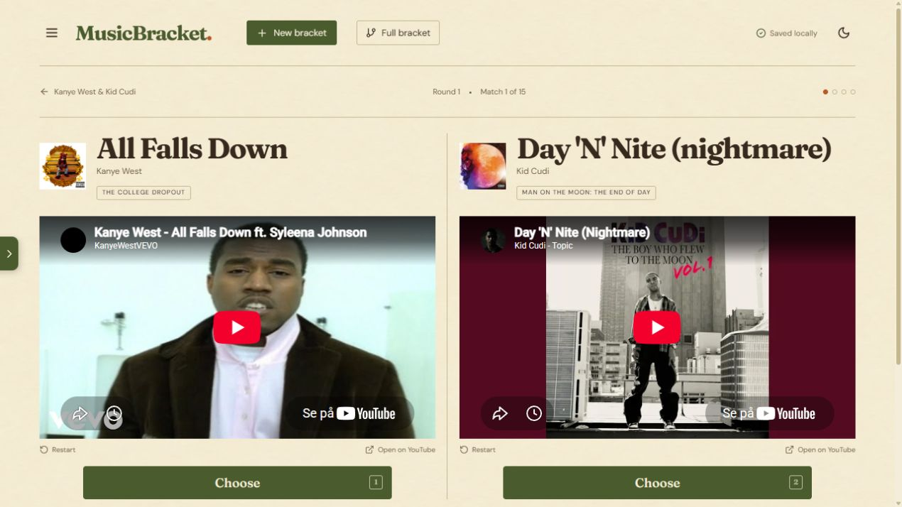
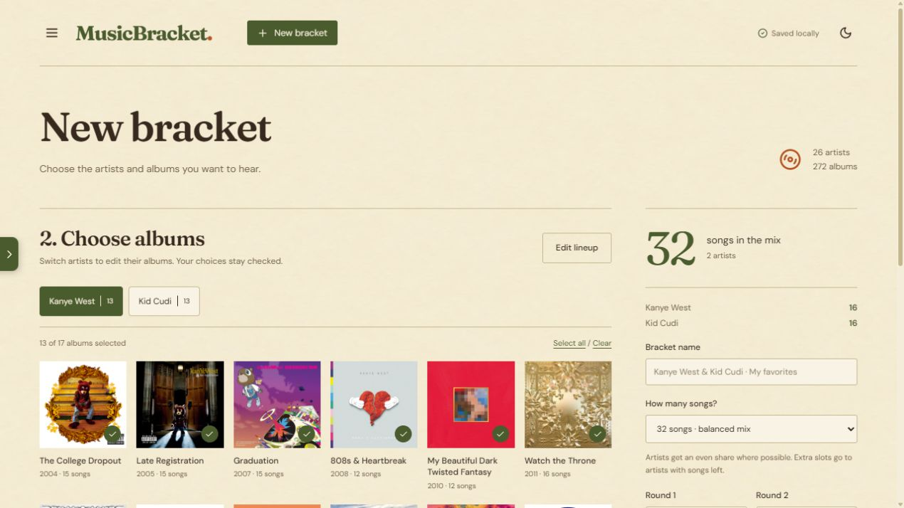

# MusicBracket

Pick your favorite songs in a knockout bracket, with YouTube playback built in. Includes **43 artists, 441 albums and 6,457 tracks**, including J. Cole, Gorillaz, The Weeknd, Lana Del Rey and Pink Floyd.

## Install & play on Windows

1. [Download the ZIP](https://github.com/dggTrivia/musicBracket/archive/refs/heads/main.zip) and **extract it**.
2. Double-click **Play-MusicBracket.bat**.
3. Wait for setup, then play in the browser that opens. **Keep the launcher window open.**

The launcher handles Node.js and dependencies automatically. First launch takes longer and needs internet. YouTube playback also needs internet.

## How to play

Choose one artist or mix 2–8, tick the albums you want, and start. Click a video to listen, then choose your favorite song in each matchup. Once playing, hover another song to switch.

- Play every selected song or a smaller bracket with balanced seeding.
- Speed up early rounds with 3–4 songs per matchup, or start songs at 40 seconds.
- Undo picks, resume saved runs, and export full-bracket or Final 16 images.
- Share an exact bracket through a replay link. Use the hosted site when sending a link to a friend.

Progress saves automatically in your browser. Light and dark modes included.

For macOS/Linux setup, architecture and coding-agent context, see the [development guide](docs/DEVELOPMENT.md).
